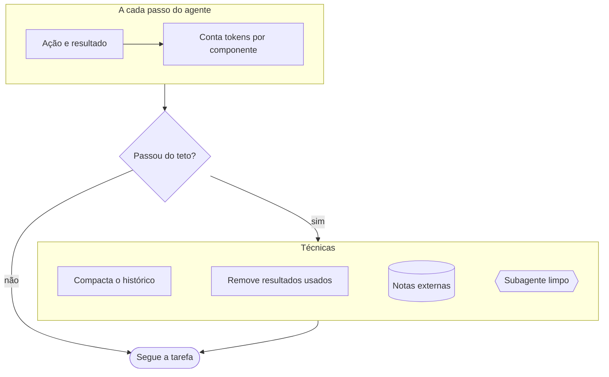

## O que é

No nível 2 você aprendeu a montar o contexto de uma chamada. Aqui o problema é outro: um agente que roda por dezenas ou centenas de passos, chamando ferramentas, lendo arquivos e acumulando resultados. O contexto cresce a cada volta, e a qualidade cai antes mesmo de a janela encher, fenômeno que ficou conhecido como context rot. Engenharia de contexto avançada é o conjunto de técnicas para manter esse agente focado durante toda a tarefa.

## Por que importa para um AI Engineer

Agentes longos são onde os sistemas atuais mais falham: repetem ações, esquecem o objetivo, seguem instruções antigas ou ficam caros demais. O estudo de context rot mostrou que o desempenho de vários modelos cai à medida que a entrada cresce, mesmo em tarefas simples. Janelas de um milhão de tokens não resolvem isso sozinhas. Quem sabe projetar o contexto de um agente longo resolve o problema mais comum dos agentes em produção.

## Como funciona

Trate o contexto como um orçamento. Defina um teto por componente e uma ação para quando ele estourar:

```python
ORCAMENTO = {"instrucoes": 3_000, "notas": 2_000, "ferramentas": 20_000, "conversa": 15_000}

def ajustar(partes, contar):
    for nome, teto in ORCAMENTO.items():
        while contar(partes[nome]) > teto and len(partes[nome]) > 1:
            if nome == "ferramentas":
                partes[nome].pop(0)              # remove o resultado mais antigo
            elif nome == "conversa":
                partes[nome] = [resumir(partes[nome][:-4])] + partes[nome][-4:]
                break                            # resume uma vez por passo
            else:
                break                            # instruções e notas: revisar à mão
    return partes

resumir = lambda msgs: "Resumo: " + " | ".join(m[:40] for m in msgs)
```

As técnicas principais:

- **Compactação:** resumir o histórico antigo quando ele passa do teto, mantendo decisões, pendências e erros já cometidos.
- **Edição de contexto:** remover resultados de ferramenta que já foram usados. Algumas APIs fazem isso automaticamente.
- **Notas externas:** o agente escreve um arquivo de progresso (objetivo, feito, a fazer) e o relê, em vez de depender do histórico.
- **Recuperação sob demanda:** em vez de carregar tudo no início, dar ao agente ferramentas para buscar só o que precisa, quando precisa.
- **Subagentes:** delegar uma subtarefa a outro agente com contexto limpo, que devolve só um resumo curto.
- **Ferramentas enxutas:** respostas de ferramenta paginadas, filtradas e com erros claros gastam menos contexto.



## Na prática

Agentes de programação usam todas essas técnicas: leem arquivos sob demanda, mantêm um arquivo de tarefas e compactam a conversa. No P5: Pesquisador Multiagente, o orquestrador mantém um arquivo de notas da pesquisa e cada subagente trabalha com contexto próprio, devolvendo só os achados com citação.

## Erros comuns

- **Confiar na janela grande.** Caber não é o mesmo que ser bem usado.
- **Compactar sem testar.** Verifique se o agente ainda sabe o objetivo e as decisões depois do resumo.
- **Ferramentas que devolvem tudo.** Uma busca que retorna 50 documentos inteiros enche o contexto em poucas voltas.
- **Não medir.** Registre tokens por componente a cada passo; sem isso, você não sabe o que cortar.

## Como estudar

1. Releia o artigo de engenharia de contexto da Anthropic, agora focando nas seções sobre tarefas longas (2 horas).
2. Leia o estudo de context rot e reproduza um teste simples com o modelo que você usa (2 dias).
3. Instrumente um agente seu para registrar tokens por componente a cada passo (1 dia).
4. Implemente compactação e notas externas e compare taxa de sucesso e custo numa tarefa longa (3 dias).
5. Leia o artigo sobre escrever ferramentas para agentes e reescreva uma ferramenta sua (1 dia).

## Como mostrar

Mostre o gráfico de tokens por passo antes e depois das técnicas, com a taxa de sucesso na mesma tarefa. Na entrevista, explique o que é context rot e qual técnica você aplicaria primeiro num agente que se perde depois de 50 passos.
