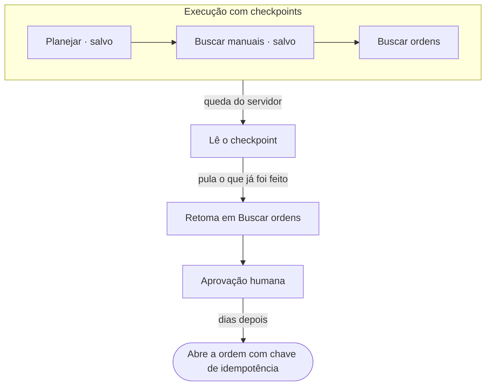

## O que é

Execução durável é a garantia de que um processo longo continua de onde parou depois de uma falha. O estado de cada passo fica salvo (checkpoint); se o servidor reinicia, a API do modelo cai ou o processo espera três dias por uma aprovação, a execução é retomada sem repetir o que já foi feito. Motores como Temporal e DBOS oferecem isso para qualquer código, e frameworks de agentes como o LangGraph têm checkpoints próprios.

## Por que importa para um AI Engineer

Um agente que roda por 40 minutos e faz 200 chamadas vai, cedo ou tarde, encontrar uma falha: limite de taxa, timeout, deploy no meio, máquina reiniciada. Sem execução durável, tudo recomeça do zero, o custo dobra e ações já feitas (um e-mail, uma ordem de serviço) podem ser repetidas. Agentes com aprovação humana pioram o problema, porque a espera pode durar dias. Esse é o ponto em que um protótipo vira um sistema que dá para operar.

## Como funciona

A ideia central: cada passo com efeito (chamar o modelo, chamar uma ferramenta) é registrado com sua entrada e seu resultado. Ao retomar, os passos já registrados devolvem o resultado salvo em vez de rodar de novo.

```python
import json, os

ARQUIVO = "checkpoint.json"
estado = json.load(open(ARQUIVO)) if os.path.exists(ARQUIVO) else {}

def passo(nome, funcao, *args):
    if nome in estado:                 # já feito: não repete
        return estado[nome]
    resultado = funcao(*args)
    estado[nome] = resultado
    json.dump(estado, open(ARQUIVO, "w"))  # salva antes de seguir
    return resultado

plano = passo("planejar", lambda p: ["manuais", "ordens"], "falha E-21")
achados = [passo(f"buscar-{f}", lambda f: f"achados em {f}", f) for f in plano]
print(achados)
```

Os motores de workflow fazem isso de forma robusta, com fila, novas tentativas, temporizadores e espera por sinais externos (como uma aprovação). Três regras valem em qualquer ferramenta:

- **Idempotência:** uma ação com efeito externo recebe uma chave única, para que repeti-la não duplique o efeito.
- **Determinismo do fluxo:** o código que decide o próximo passo não pode depender de algo que muda ao reexecutar, como a hora atual; isso fica dentro de um passo registrado.
- **Novas tentativas com limite:** erros temporários são repetidos com espera crescente; erros permanentes param e avisam.



## Na prática

Agentes de pesquisa longa, agentes que abrem chamados e esperam resposta e pipelines de processamento de documentos usam execução durável. No P5: Pesquisador Multiagente, uma investigação pode esperar a aprovação de um engenheiro antes de abrir a ordem de serviço, e o sistema precisa sobreviver a um reinício nesse meio tempo.

## Erros comuns

- **Guardar só o estado final.** Se cair no meio, você perde tudo o que veio antes.
- **Ações sem chave de idempotência.** A retomada envia o mesmo e-mail duas vezes.
- **Decisões fora dos passos registrados.** O fluxo toma outro caminho ao retomar.
- **Repetir para sempre.** Sem limite, um erro permanente vira custo infinito.

## Como estudar

1. Leia os conceitos de execução durável do LangGraph e a introdução do Temporal (1 dia).
2. Rode o exemplo acima, interrompa com Ctrl+C no meio e rode de novo (1 hora).
3. Implemente um agente com checkpoints num motor de sua escolha e simule quedas (1 semana).
4. Adicione uma espera por aprovação humana que sobrevive a reinício (2 dias).
5. Adicione chave de idempotência na ferramenta que tem efeito externo e teste a retomada (1 dia).

## Como mostrar

Grave um vídeo curto matando o processo no meio de uma tarefa e mostrando a retomada sem repetir ações. No README, explique a política de novas tentativas e de idempotência. Na entrevista, descreva o que acontece com seu agente se o servidor reiniciar durante uma aprovação.
