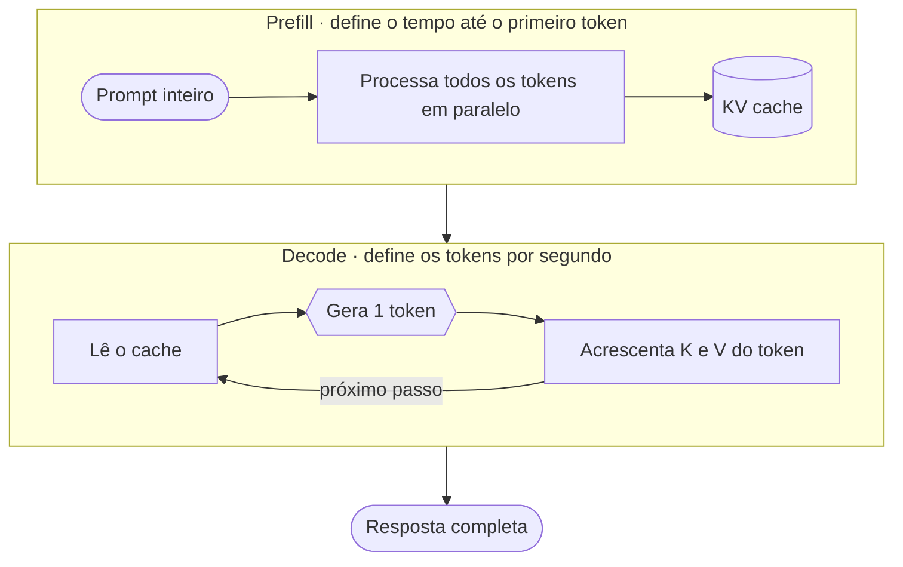

## O que é

Inferência é rodar o modelo para gerar texto. Ela tem duas fases. No prefill, o modelo lê o prompt inteiro de uma vez, em paralelo. No decode, gera um token por vez, e cada token novo depende de todos os anteriores. O KV cache guarda as chaves (K) e os valores (V) da atenção de cada token já processado, para que o modelo não precise recalculá-los a cada passo do decode.



## Por que importa para um AI Engineer

Quase toda conversa sobre custo e latência de LLM passa por aqui. O tempo até o primeiro token depende do prefill, ou seja, do tamanho do prompt. A velocidade de geração depende do decode, limitada pela leitura de memória da GPU. O prompt caching dos provedores é, na prática, reaproveitar o KV cache de um início de prompt igual. E o KV cache ocupa memória que cresce com o contexto e com o número de usuários simultâneos: é ele, muitas vezes, e não os pesos, que limita quantas requisições uma GPU atende.

## Como funciona

O tamanho do cache por token é: 2 (K e V) vezes o número de camadas, vezes o número de cabeças de K/V, vezes a dimensão de cada cabeça, vezes os bytes por número. A conta abaixo usa uma configuração típica de um modelo de 8 bilhões de parâmetros com GQA (grouped-query attention, em que várias cabeças de consulta dividem as mesmas chaves e valores).

```python
camadas, cabecas_kv, dim_cabeca, bytes_fp16 = 32, 8, 128, 2
por_token = 2 * camadas * cabecas_kv * dim_cabeca * bytes_fp16
print(por_token / 1024, "KiB por token")                 # 128.0 KiB

contexto, usuarios = 32_000, 10
total = por_token * contexto * usuarios
print(round(total / 1024**3, 1), "GiB só de KV cache")   # 39.1 GiB
```

Sem GQA (32 cabeças de K/V em vez de 8), seriam quatro vezes mais. Por isso as técnicas de inferência atacam essa memória e o decode:

- **PagedAttention:** guarda o cache em blocos, como a memória virtual de um sistema operacional, e quase elimina o desperdício. É a base do vLLM.
- **Batching contínuo:** junta requisições de usuários diferentes no mesmo passo de decode.
- **Speculative decoding:** um modelo pequeno propõe vários tokens e o grande confere todos de uma vez, mantendo a mesma distribuição de saída.
- **FlashAttention:** reorganiza o cálculo da atenção para ler e escrever menos na memória da GPU.
- **Quantizar o cache:** guardar K e V em 8 bits em vez de 16.

## Na prática

Prompts com início fixo (instruções, ferramentas) ficam mais baratos com prompt caching. Contextos muito longos aumentam o tempo até o primeiro token e o custo de memória. No P5: Pesquisador Multiagente, você mede tempo até o primeiro token e tokens por segundo do subagente servido localmente e explica os números com essa conta.

## Erros comuns

- **Medir só o tempo total.** Separe tempo até o primeiro token e tokens por segundo; as causas são diferentes.
- **Calcular memória só pelos pesos.** Com contexto longo e vários usuários, o cache passa os pesos.
- **Variar o início do prompt.** Um timestamp no começo invalida o cache a cada chamada.
- **Esperar que speculative decoding sempre ajude.** Se o modelo pequeno erra muito, o ganho some.

## Como estudar

1. Leia o artigo sobre KV cache da Hugging Face (2 horas).
2. Refaça a conta acima para dois modelos abertos, lendo o arquivo de configuração de cada um (1 dia).
3. Gere texto com o Transformers com e sem cache e compare o tempo (1 dia).
4. Leia o resumo e as figuras dos artigos do PagedAttention e do speculative decoding (2 dias).
5. Meça o tempo até o primeiro token de uma API com e sem prompt caching (1 dia).

## Como mostrar

No README do P5, inclua a tabela de memória do KV cache por contexto e por número de usuários e os tempos medidos. Na entrevista, explique a diferença entre prefill e decode e por que o decode é limitado por memória, não por cálculo.
