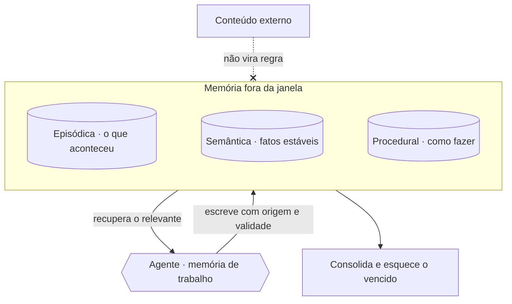

## O que é

Um LLM não lembra nada entre chamadas: tudo o que ele sabe sobre a conversa está no contexto. Memória de agente é a parte do sistema que guarda informação fora do contexto e a traz de volta quando é útil. Costuma-se dividir em quatro tipos:

- **De trabalho:** o que está no contexto agora (a tarefa, as últimas mensagens, as notas).
- **Episódica:** o que aconteceu em sessões anteriores ("na semana passada o técnico perguntou sobre o X200").
- **Semântica:** fatos estáveis ("este usuário trabalha na linha de motores").
- **Procedural:** como fazer as coisas: instruções e procedimentos que o agente aprendeu ou que você refinou.

## Por que importa para um AI Engineer

Assistentes que lembram preferências e decisões são mais úteis, e agentes que aprendem com erros anteriores ficam mais confiáveis. Mas memória é também uma fonte nova de falhas: um fato errado salvo uma vez aparece em todas as respostas seguintes, dados pessoais ficam guardados sem prazo e uma instrução maliciosa pode ser gravada e virar comando no futuro. Projetar memória é decidir o que guardar, por quanto tempo, com que confiança e com qual controle do usuário.

## Como funciona

O ciclo tem três decisões: quando escrever, como recuperar e quando esquecer. Uma forma simples é dar ao agente ferramentas explícitas de memória, para que a escrita seja uma decisão registrada e auditável:

```python
from datetime import datetime, timedelta

MEMORIA = []

def lembrar(usuario, fato, fonte, dias_validade=90):
    MEMORIA.append({"usuario": usuario, "fato": fato, "fonte": fonte,
                    "expira": datetime.now() + timedelta(days=dias_validade)})

def recordar(usuario, termo):
    agora = datetime.now()
    return [m["fato"] for m in MEMORIA
            if m["usuario"] == usuario and m["expira"] > agora and termo.lower() in m["fato"].lower()]

lembrar("tec-12", "Trabalha na linha de motores X200", fonte="conversa 2026-11-20")
print(recordar("tec-12", "x200"))
```

Num sistema real, a busca usa embeddings num banco como o Postgres com pgvector, cada memória guarda a origem e a data, e há uma rotina que consolida memórias repetidas e apaga as vencidas. O MemGPT propôs tratar o contexto como memória principal e o banco como disco, com o próprio modelo movendo informação entre os dois.



## Na prática

Assistentes com memória de preferências, agentes de programação com arquivos de instruções do projeto e agentes de suporte que lembram o histórico do cliente usam essas ideias. No P5: Pesquisador Multiagente, a memória guarda o que já foi pesquisado e as conclusões validadas, para que uma pergunta parecida reaproveite o trabalho com citação da sessão original.

## Erros comuns

- **Salvar tudo automaticamente.** A memória enche de ruído e de fatos errados; prefira escrita seletiva.
- **Memória sem origem.** Sem saber de onde veio um fato, ninguém consegue corrigi-lo.
- **Guardar dado pessoal sem prazo nem forma de apagar.** Veja o tópico de LGPD.
- **Tratar memória como confiável.** Ela é dado, não instrução; conteúdo vindo de documentos externos não deve virar regra.
- **Misturar usuários.** Isole a memória por usuário e por organização.

## Como estudar

1. Leia o artigo do MemGPT, focando na arquitetura (1 dia).
2. Leia os conceitos de memória do LangGraph para ver os tipos aplicados (2 horas).
3. Implemente as ferramentas de lembrar e recordar com pgvector, com origem e validade (3 dias).
4. Crie testes: um fato desatualizado, um pedido para esquecer e uma instrução maliciosa num documento (2 dias).
5. Meça se a memória melhora as respostas em perguntas repetidas e quanto custa (1 dia).

## Como mostrar

Mostre o esquema da memória (campos, origem, validade), a política de escrita e de esquecimento e os testes de falha. Na entrevista, explique como você impediria que uma memória errada ou maliciosa se espalhasse.
