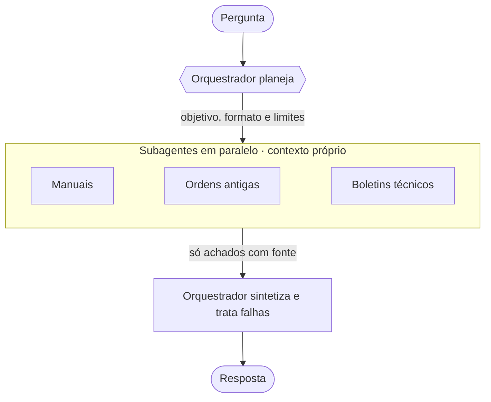

## O que é

Um sistema multiagente divide uma tarefa entre vários agentes, cada um com seu próprio contexto, instruções e ferramentas. O padrão mais usado é o orquestrador com subagentes: um agente principal planeja, distribui subtarefas, recebe os resultados e monta a resposta. Outros padrões são a sequência de especialistas (cada um passa o resultado ao próximo) e o debate ou revisão (um agente produz e outro critica).

## Por que importa para um AI Engineer

Multiagentes viraram moda, e a decisão de usar ou não é das mais discutidas em entrevistas de arquitetura. Os dois artigos de referência deste tópico chegam a recomendações que parecem opostas. Um relata ganho grande numa tarefa de pesquisa ampla, em que subagentes paralelos exploram caminhos independentes, com custo de tokens bem maior que um agente único. O outro argumenta que, em tarefas em que as decisões dependem umas das outras, como escrever código, dividir o contexto gera decisões conflitantes. Saber em qual caso você está é o que importa.

## Como funciona

A regra prática: vários agentes ajudam quando as subtarefas são independentes, podem rodar em paralelo e cada uma precisa de muito contexto próprio. Atrapalham quando as partes precisam compartilhar decisões finas.

```python
import asyncio

async def subagente(tarefa: str) -> str:
    await asyncio.sleep(0.1)                     # aqui entra o agente real
    return f"achados sobre: {tarefa} [fonte]"

async def orquestrador(pergunta: str) -> str:
    plano = [f"{pergunta} — manuais", f"{pergunta} — ordens antigas",
             f"{pergunta} — boletins técnicos"]  # o modelo planejaria isto
    achados = await asyncio.gather(*(subagente(t) for t in plano))
    return "\n".join(achados)                    # o modelo sintetizaria isto

print(asyncio.run(orquestrador("falha E-21 no X200")))
```

Os pontos difíceis estão nos detalhes:

- **Instruções de delegação:** cada subagente precisa de objetivo, formato de saída, limites e quando parar. Instruções vagas geram trabalho duplicado.
- **O que volta:** só o resumo dos achados, com fontes, para não encher o contexto do orquestrador.
- **Esforço proporcional:** pergunta simples, um subagente; pergunta ampla, vários.
- **Falhas parciais:** um subagente que falha não pode derrubar tudo; o orquestrador decide se refaz ou segue sem ele.



## Na prática

Sistemas de pesquisa profunda, que buscam em muitas fontes ao mesmo tempo, são o caso de sucesso mais claro. Agentes de programação, em geral, mantêm um agente principal e usam subagentes só para tarefas isoladas, como buscar algo no repositório. No P5: Pesquisador Multiagente, o orquestrador divide uma investigação de falha em buscas paralelas nos manuais, nas ordens de manutenção e nos boletins.

## Erros comuns

- **Começar com vários agentes.** Construa o agente único primeiro e meça; divida só se os dados mostrarem ganho.
- **Agentes que conversam livremente entre si.** O custo e a imprevisibilidade explodem; prefira um fluxo claro.
- **Subtarefas dependentes em paralelo.** Geram resultados que não se encaixam.
- **Avaliar só a resposta final.** Olhe o plano, a delegação e os achados de cada subagente.

## Como estudar

1. Leia os dois artigos principais e anote quando cada um recomenda vários agentes (1 dia).
2. Construa um agente único para uma tarefa de pesquisa e meça acerto, tokens e tempo (3 dias).
3. Transforme em orquestrador com subagentes paralelos e meça de novo (1 semana).
4. Teste uma tarefa com partes dependentes e observe as falhas (2 dias).
5. Escreva uma página de decisão: quando usar cada abordagem, com seus números (1 dia).

## Como mostrar

Mostre a comparação entre agente único e multiagente na mesma tarefa: acerto, custo, tempo e exemplos de falha de cada um. Na entrevista, defenda a escolha com esses dados e cite quando você não usaria vários agentes.
