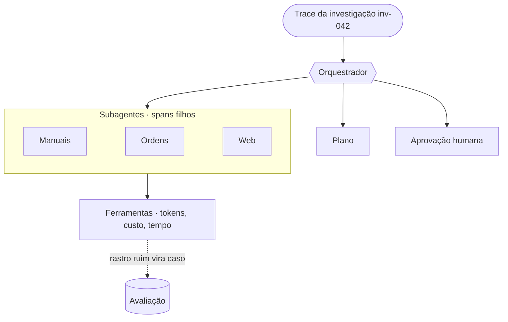

## O que é

No nível 4 você rastreou chamadas de um sistema com LLM. Num agente, uma única tarefa vira dezenas de chamadas ao modelo, ferramentas e, às vezes, outros agentes, ao longo de minutos ou horas. Observabilidade de agentes é organizar tudo isso num rastro (trace) único por tarefa, com spans aninhados: a tarefa contém os passos, cada passo contém a chamada ao modelo e as ferramentas, e cada subagente tem sua própria árvore dentro da do orquestrador.



## Por que importa para um AI Engineer

Quando um agente erra, a pergunta é sempre "em que passo e por quê?". Sem rastro, você não sabe se o problema foi o plano, uma ferramenta que devolveu lixo, um subagente que se perdeu ou o contexto que estourou. Agentes também são não determinísticos, então o erro pode não se repetir. E o custo por tarefa varia muito: uma investigação pode custar centavos ou dólares. Observabilidade é o que permite depurar, controlar custo e alimentar a avaliação com casos reais.

## Como funciona

O OpenTelemetry tem convenções semânticas para IA generativa: nomes padrão de atributos para modelo, tokens de entrada e saída, chamada de ferramenta e agente. Seguir o padrão deixa você trocar de ferramenta de visualização sem reescrever a instrumentação.

```python
from opentelemetry import trace
from opentelemetry.sdk.trace import TracerProvider
from opentelemetry.sdk.trace.export import ConsoleSpanExporter, SimpleSpanProcessor

provedor = TracerProvider()
provedor.add_span_processor(SimpleSpanProcessor(ConsoleSpanExporter()))
trace.set_tracer_provider(provedor)
tracer = trace.get_tracer("pesquisador")

with tracer.start_as_current_span("invoke_agent orquestrador") as tarefa:
    tarefa.set_attribute("tarefa.id", "inv-042")
    with tracer.start_as_current_span("execute_tool buscar_no_manual") as span:
        span.set_attribute("gen_ai.tool.name", "buscar_no_manual")
        span.set_attribute("gen_ai.usage.input_tokens", 1840)
```

O que registrar em cada tarefa:

- **Estrutura:** plano, passos, subagentes e ferramentas, com tempo de cada um.
- **Custo:** tokens e valor por passo, somados por tarefa e por usuário.
- **Decisões:** qual ferramenta foi escolhida e com quais argumentos (com dados pessoais mascarados).
- **Resultado:** sucesso, falha, abandono, aprovação humana pedida e concedida.
- **Ligação com a avaliação:** um rastro ruim vira, com um clique ou um script, um caso novo no conjunto de testes.

Em sistemas multiagentes, propague o identificador do rastro entre agentes, inclusive via A2A, para que tudo apareça numa árvore só.

## Na prática

Ferramentas como Langfuse e outras plataformas de observabilidade de LLM leem esses rastros e mostram a árvore, o custo e as notas de avaliação lado a lado. No P5: Pesquisador Multiagente, cada investigação tem um rastro com o orquestrador, os subagentes paralelos e a aprovação humana, e um painel de custo por investigação.

## Erros comuns

- **Rastros separados por subagente.** Sem propagação do contexto, você perde a visão da tarefa.
- **Registrar prompts inteiros com dados pessoais.** Mascare antes de enviar.
- **Medir só latência.** Para agentes, custo e número de passos por tarefa dizem mais.
- **Rastros que ninguém olha.** Defina alertas (custo acima do normal, passos demais) e revise falhas toda semana.

## Como estudar

1. Leia as convenções semânticas de IA generativa do OpenTelemetry (2 horas).
2. Rode o exemplo acima e veja os spans aninhados no console (1 hora).
3. Instrumente um agente com orquestrador e subagentes, enviando para o Langfuse ou outra ferramenta (3 dias).
4. Crie um painel de custo e passos por tarefa e um alerta simples (1 dia).
5. Escreva o script que transforma um rastro marcado como ruim num caso de avaliação (1 dia).

## Como mostrar

Mostre uma captura da árvore de uma investigação, o painel de custo por tarefa e um caso real que saiu de um rastro ruim e virou teste. Na entrevista, explique como você encontra o passo em que um agente multiagente errou.
