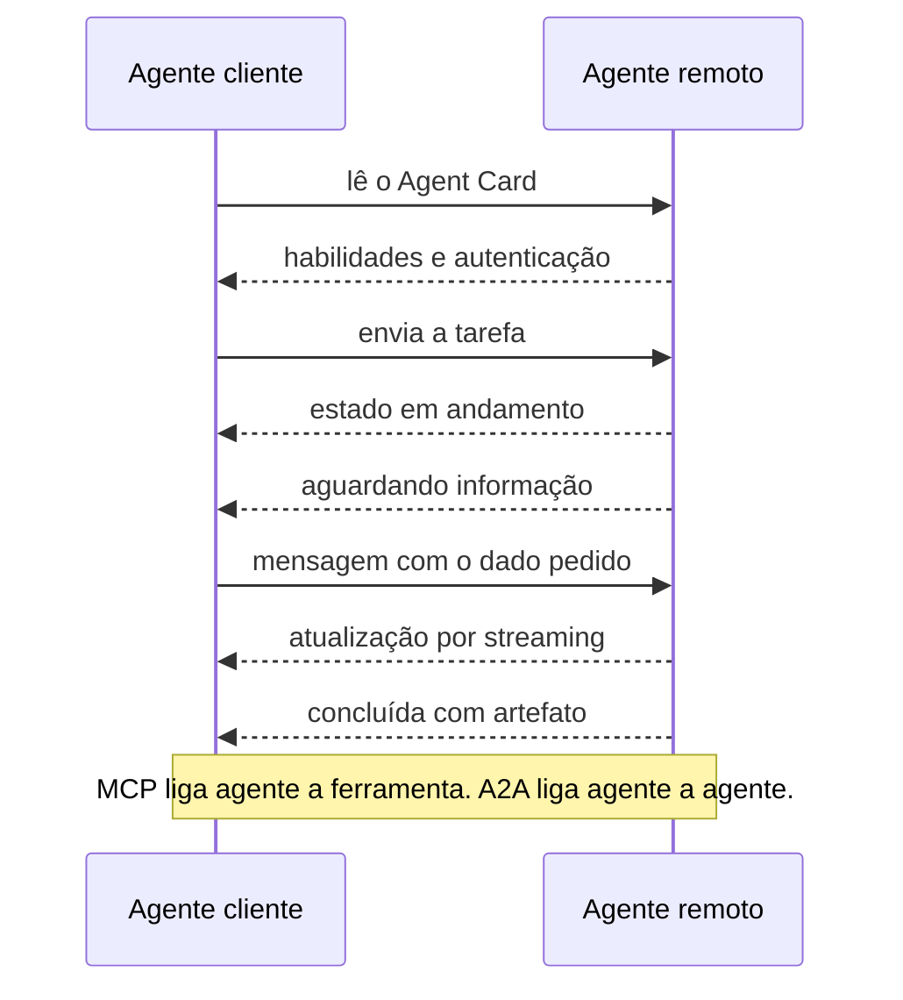

## O que é

O Agent2Agent (A2A) é um protocolo aberto para que agentes construídos por equipes, empresas ou frameworks diferentes conversem entre si. Um agente publica o que sabe fazer num Agent Card (um documento JSON com nome, descrição, habilidades, endereço e forma de autenticação), e outro agente pode enviar uma tarefa para ele, acompanhar o andamento e receber o resultado. O projeto é mantido de forma aberta, com especificação e SDKs públicos.

## Por que importa para um AI Engineer

O MCP padronizou como um agente usa ferramentas e dados. O A2A tenta padronizar outra coisa: como um agente delega trabalho a outro agente que ele não controla. Em empresas grandes, times diferentes constroem agentes diferentes (um de compras, um de suporte, um de manutenção), e integrá-los um a um não escala. Entender o protocolo, e saber diferenciar bem de MCP, é útil em conversas de arquitetura, mesmo que o padrão ainda esteja amadurecendo.

## Como funciona

A diferença com o MCP é o que está do outro lado. No MCP, o outro lado é uma ferramenta: recebe argumentos e devolve um resultado, sem autonomia. No A2A, o outro lado é um agente: recebe uma tarefa em linguagem natural e decide como cumpri-la, pode pedir mais informação, demorar e mandar atualizações.

Os conceitos principais:

- **Agent Card:** a descrição pública do agente, geralmente servida num endereço conhecido do domínio.
- **Tarefa (task):** a unidade de trabalho, com estados como enviada, em andamento, aguardando informação, concluída ou falhou.
- **Mensagens e artefatos:** a conversa durante a tarefa e os resultados produzidos (texto, arquivos, dados).
- **Transporte:** requisições HTTP com JSON-RPC, com opção de streaming para tarefas longas e notificações para avisar quando terminar.



```python
import json

agent_card = {
    "name": "Agente de Manutenção",
    "description": "Investiga falhas de equipamento a partir de manuais e ordens de serviço.",
    "url": "https://agentes.exemplo.com/manutencao",
    "version": "1.0.0",
    "capabilities": {"streaming": True},
    "skills": [{"id": "investigar-falha", "name": "Investigar falha",
                "description": "Recebe código de erro e equipamento; devolve causas prováveis com fontes."}],
}
print(json.dumps(agent_card, indent=2, ensure_ascii=False))
```

Os nomes exatos dos campos mudam entre versões; confira a especificação atual antes de implementar.

## Na prática

O A2A faz sentido quando agentes pertencem a donos diferentes ou rodam em plataformas diferentes. Dentro de um único sistema seu, chamar subagentes diretamente costuma ser mais simples. No P5: Pesquisador Multiagente, uma camada expõe o pesquisador como agente A2A, para que outro agente (por exemplo, um de abertura de ordens) possa delegar investigações a ele.

## Erros comuns

- **Usar A2A onde uma função bastaria.** Protocolo entre agentes adiciona latência e complexidade.
- **Confundir com MCP.** MCP é agente para ferramenta; A2A é agente para agente. Muitos sistemas usam os dois.
- **Confiar no Agent Card.** Ele é uma declaração, não uma garantia; autentique e limite o que o outro agente pode pedir.
- **Ignorar tarefas longas.** Sem streaming ou notificações, o cliente fica esperando sem saber o estado.

## Como estudar

1. Leia a visão geral e os conceitos principais na documentação do A2A (2 horas).
2. Compare com o MCP numa tabela: quem está do outro lado, estado, autonomia, casos de uso (2 horas).
3. Rode um dos exemplos do repositório oficial com dois agentes conversando (2 dias).
4. Exponha um agente seu com Agent Card e uma habilidade, e chame de outro processo (2 dias).
5. Adicione autenticação e um limite de tarefas por cliente (1 dia).

## Como mostrar

Mostre o Agent Card, um diagrama de quem fala com quem (MCP para ferramentas, A2A entre agentes) e um registro de uma tarefa com mudança de estado. Na entrevista, explique a diferença entre os dois protocolos e quando você não usaria nenhum deles.
