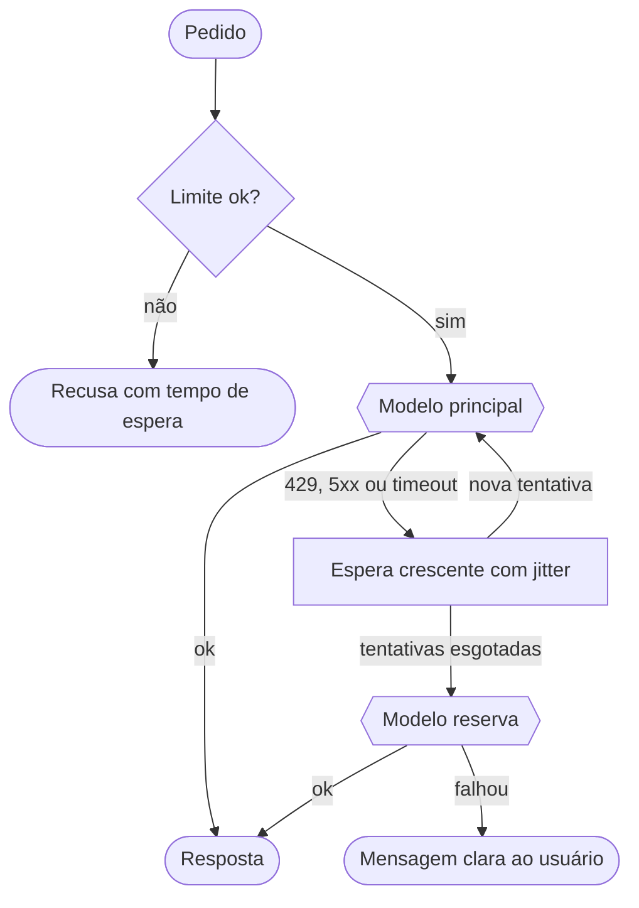

## O que é

Rate limit (limite de taxa) é o teto de requisições que um serviço aceita num período. Há dois lados: o provedor do modelo limita você, e você limita os seus usuários. Fallback é o plano B quando algo falha: tentar de novo, usar outro modelo ou outro provedor, ou responder de forma reduzida.

## Por que importa para um AI Engineer

Provedores de LLM têm limites de requisições e de tokens por minuto, e às vezes ficam fora do ar ou lentos. Sem tratamento, o erro chega ao usuário. Sem limite por usuário, um só pode esgotar a sua cota (ou gerar uma fatura alta) e derrubar o serviço para os outros. Tratar isso é o que separa uma demonstração de um serviço no ar.

## Como funciona

**Limite por usuário.** Dê a cada usuário (ou chave de API) um número máximo de pedidos por janela de tempo. Uma técnica comum é o token bucket (balde de fichas): cada pedido gasta uma ficha, e as fichas voltam num ritmo fixo. O contador fica num armazenamento compartilhado, como o Redis, para valer em várias instâncias da API. Ao exceder, devolva o código HTTP 429 (Too Many Requests) com o tempo de espera. Limite também o tamanho da entrada e dos tokens de saída, porque o custo vem deles.

**Erro 429 do provedor.** Significa que você excedeu o limite do provedor. Leia o cabeçalho que indica quanto esperar (a API do Claude traz o `retry-after`) e respeite. Erros 5xx, o 529 (serviço sobrecarregado, na API da Anthropic) e o tempo esgotado também são temporários.

**Retry com backoff.** Tentar de novo imediatamente piora a sobrecarga. Use espera crescente (backoff exponencial) mais um valor aleatório (jitter), para que muitos clientes não tentem todos juntos, e um número máximo de tentativas. Só repita o que é temporário e idempotente (repetir tem o mesmo efeito que fazer uma vez; veja tool-use). Os SDKs dos provedores já têm retries automáticos, então confira o que o seu faz antes de somar outro por cima.

**Timeouts.** Defina um tempo máximo de espera em cada chamada. Sem ele, uma requisição travada prende a sua API.

**Fallback.** Se as tentativas esgotam, troque de caminho:

```python
import random, time
def com_retry(chamada, tentativas=4):
    for i in range(tentativas):
        try:
            return chamada()
        except ErroTemporario:  # 429, 5xx, 529, timeout (sua classe)
            if i == tentativas - 1:
                raise
            time.sleep(min(2 ** i, 20) + random.random())  # backoff + jitter
def responder(pergunta):
    try:
        return com_retry(lambda: modelo_principal(pergunta))
    except ErroTemporario:
        return com_retry(lambda: modelo_reserva(pergunta))
```

`ErroTemporario`, `modelo_principal` e `modelo_reserva` são seus: agrupam os erros do SDK e as chamadas. O modelo de reserva pode ser menor e mais barato, de outro provedor ou até uma mensagem de "tente de novo em instantes". Teste o reserva com os mesmos evals: o prompt e o formato da saída podem se comportar de outro jeito. Compare também o custo, para o fallback não disparar a fatura.



## Na prática

No PF: Agente Completo, a API aplica limite por usuário, repete com backoff os erros temporários e troca para um modelo de reserva quando o principal falha, e tudo isso aparece nos traces (veja observabilidade). As chamadas longas, como uma indexação em lote, vão para filas (veja filas-e-tarefas-assincronas), que controlam o ritmo de envio ao provedor. Os números de custo vêm de custo-e-latencia.

## Erros comuns

- **Retry sem limite ou sem espera.** Vira uma tempestade de requisições contra um serviço já sobrecarregado.
- **Repetir ação que escreve sem idempotência.** Duplica o efeito.
- **Sem timeout.** Uma chamada travada ocupa a sua API.
- **Fallback nunca testado.** Na hora do problema, ele falha também.
- **Somar retries do SDK e os seus** sem perceber: multiplica as tentativas.

## Como estudar

1. Leia a página de rate limits do provedor que usa (1 hora).
2. Leia o artigo da Builders' Library sobre backoff com jitter (1 hora).
3. Implemente `com_retry` e teste com um dublê que falha duas vezes (1 dia).
4. Adicione um limite por usuário na API, em memória e depois com Redis (1 a 2 dias).
5. Implemente o modelo de reserva e rode os evals nos dois (1 dia).

## Como mostrar

No portfólio, o README do PF descreve a política: limite por usuário, número de tentativas, timeouts e qual é o fallback, com um teste que simula a falha do provedor. Na entrevista, explique por que o jitter existe e como você evitou que o fallback aumentasse o custo.
