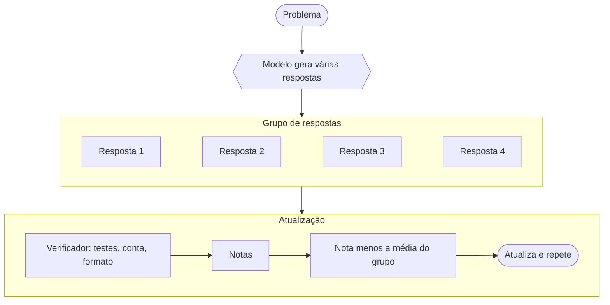

## O que é

Aprendizado por reforço (reinforcement learning, RL) ajusta um modelo pela recompensa que suas respostas recebem, e não por exemplos prontos. Em RL com recompensa verificável (RLVR), a recompensa vem de um programa que confere a resposta: o código passou nos testes, a conta bateu, o JSON tem o formato certo. Antes disso, o mais comum era RLHF, em que a recompensa vem de um modelo treinado com preferências humanas.

## Por que importa para um AI Engineer

É assim que os laboratórios ensinam modelos a raciocinar e a usar ferramentas, e cada vez mais empresas usam a mesma ideia para especializar modelos abertos numa tarefa própria. Mesmo que você não treine um modelo grande, entender RLVR muda como você pensa avaliação: se você tem um verificador automático confiável, ele serve tanto para medir quanto para treinar. E ajuda a ler os relatórios técnicos de modelos novos.

## Como funciona

No GRPO (group relative policy optimization), um algoritmo popular para isso, o modelo gera várias respostas para o mesmo problema. Cada uma recebe a recompensa do verificador. A vantagem de cada resposta é a recompensa dela comparada com a média do grupo: respostas acima da média ficam mais prováveis, as abaixo, menos. Não é preciso treinar um modelo de recompensa separado.



O coração do trabalho é a função de recompensa. No TRL, ela é uma função Python que recebe as respostas e devolve uma nota para cada uma:

```python
import json

def recompensa_json(completions, **kwargs):
    """1.0 se a resposta é um JSON com os campos certos, 0.0 se não."""
    notas = []
    for texto in completions:
        try:
            dado = json.loads(texto)
            notas.append(1.0 if {"codigo", "gravidade"} <= dado.keys() else 0.3)
        except (json.JSONDecodeError, AttributeError):
            notas.append(0.0)
    return notas

print(recompensa_json(['{"codigo": "E-21", "gravidade": "alta"}', "não sei"]))
```

Essa função entra no treinador GRPO do TRL junto com o modelo e os problemas. Um modelo pequeno (menos de 1 bilhão de parâmetros) já mostra o efeito numa GPU modesta.

## Na prática

Os usos mais comuns fora dos laboratórios são ensinar um modelo pequeno a seguir um formato rígido, a chamar ferramentas do seu sistema ou a resolver uma tarefa com resposta conferível. No P5: Pesquisador Multiagente, é uma camada opcional: ajustar o modelo aberto do subagente de classificação com uma recompensa que confere o formato e o rótulo, e comparar com o modelo original nos evals.

## Erros comuns

- **Recompensa que dá para enganar.** O modelo encontra atalhos (reward hacking); se a recompensa só confere o formato, ele aprende só o formato.
- **Treinar sem eval separado.** Meça num conjunto que não entrou no treino.
- **Começar grande.** Teste a recompensa num modelo pequeno e poucos passos antes de gastar GPU.
- **Usar RL quando um bom prompt ou fine-tuning supervisionado resolveria.** RL é mais caro e instável.

## Como estudar

1. Faça as primeiras unidades do curso de RL da Hugging Face para os conceitos de política e recompensa (1 semana).
2. Leia a página do GRPO Trainer no TRL e rode o exemplo da documentação (2 dias).
3. Escreva uma função de recompensa para uma tarefa sua e teste com respostas boas e ruins antes de treinar (1 dia).
4. Treine um modelo pequeno por poucos passos e compare com o original nos seus evals (3 a 5 dias, com alerta de custo).
5. Leia a seção de RLVR do relatório do Tulu 3 (1 dia).

## Como mostrar

Publique a função de recompensa, os gráficos de recompensa média durante o treino e a comparação antes e depois num eval separado, incluindo um caso de reward hacking que você encontrou e corrigiu. Na entrevista, explique a diferença entre RLHF e RLVR.
