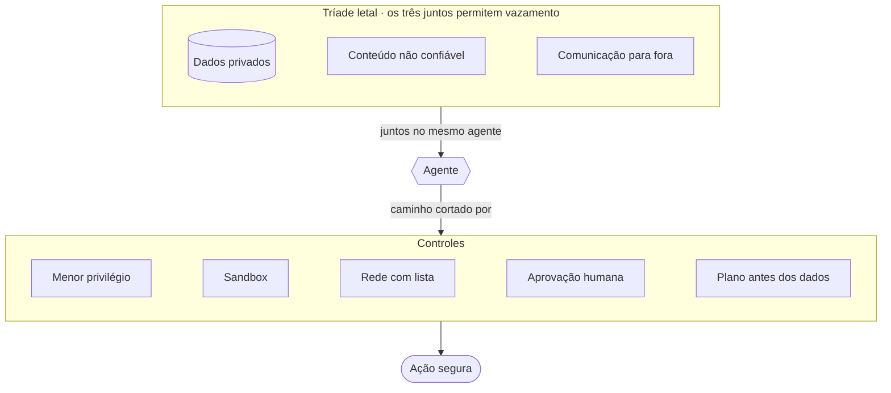

## O que é

Segurança de agentes é proteger um sistema em que o modelo decide sozinho quais ferramentas chamar. O ataque mais comum é a prompt injection indireta: uma instrução escondida num documento, e-mail ou página que o agente lê e passa a obedecer. Num chatbot, isso gera uma resposta errada. Num agente com acesso a e-mail, banco de dados e internet, pode virar vazamento de dados ou ação destrutiva.

## Por que importa para um AI Engineer

Não existe hoje um filtro que bloqueie prompt injection com garantia. Por isso, a defesa precisa estar na arquitetura, não só no prompt. Uma forma útil de pensar é a tríade letal: o risco é alto quando o agente tem, ao mesmo tempo, acesso a dados privados, exposição a conteúdo não confiável e um meio de comunicar para fora. Remover qualquer um dos três corta o caminho do vazamento. Empresas grandes só liberam agentes com ferramentas quando alguém consegue explicar essa análise.

## Como funciona

Comece pela modelagem de ameaças: para cada ferramenta, anote o que ela lê, o que ela altera e se o conteúdo que ela traz é confiável. Depois aplique os controles:

- **Menor privilégio:** cada ferramenta com a permissão mínima; leitura não escreve.
- **Sandbox:** código e navegação rodam isolados, com sistema de arquivos e rede restritos.
- **Rede com lista de permissões:** o agente só fala com os domínios de que a tarefa precisa.
- **Aprovação humana para ações irreversíveis ou externas.**
- **Separação entre plano e dados:** o plano de ações é decidido antes de ler conteúdo não confiável, e esse conteúdo só entra como dado, nunca como instrução. O artigo do CaMeL formaliza essa ideia.



```python
FERRAMENTAS = {
    "ler_manual":       {"dados_privados": True,  "nao_confiavel": False, "sai_para_fora": False},
    "buscar_na_web":    {"dados_privados": False, "nao_confiavel": True,  "sai_para_fora": True},
    "ler_email":        {"dados_privados": True,  "nao_confiavel": True,  "sai_para_fora": False},
    "enviar_email":     {"dados_privados": False, "nao_confiavel": False, "sai_para_fora": True},
}

def triade_letal(ativas):
    tem = lambda chave: any(FERRAMENTAS[f][chave] for f in ativas)
    return tem("dados_privados") and tem("nao_confiavel") and tem("sai_para_fora")

print(triade_letal(["ler_manual", "buscar_na_web"]))       # True: risco de vazamento
print(triade_letal(["ler_manual", "ler_email"]))           # False
```

Por fim, teste como atacante: coloque instruções maliciosas nos documentos, nas respostas das ferramentas e na memória, e verifique o que o agente faz.

## Na prática

Agentes de programação rodam comandos em sandbox com rede limitada e pedem aprovação para ações fora dela. Assistentes de e-mail separam leitura de envio. No P5: Pesquisador Multiagente, a busca na web roda num subagente sem acesso aos dados internos, e a abertura de ordem de serviço exige aprovação humana, quebrando a tríade.

## Erros comuns

- **Confiar num prompt de sistema "não obedeça instruções de documentos".** Ajuda pouco contra um ataque bem feito.
- **Dar todas as ferramentas a todos os agentes.** Cada subagente deve ter só o que precisa.
- **Segredos no contexto.** Chaves e senhas ficam nas ferramentas, nunca no texto que o modelo vê.
- **Testar só ataques diretos.** O perigo maior vem do conteúdo que o agente lê.
- **Registrar pouco.** Sem log de cada ação e de quem aprovou, não há investigação depois.

## Como estudar

1. Leia o texto da tríade letal e o OWASP Top 10 para LLM (2 horas).
2. Leia o artigo de prompt injection indireta, focando nos cenários de ataque (1 dia).
3. Faça a tabela de ameaças das ferramentas de um agente seu (1 dia).
4. Monte 15 ataques escondidos em documentos e respostas de ferramenta e meça quantos passam (3 dias).
5. Aplique sandbox, lista de domínios e aprovação, e rode os ataques de novo (3 dias).
6. Leia o artigo do CaMeL para a ideia de separar plano e dados (1 dia).

## Como mostrar

Publique a tabela de ameaças, o conjunto de ataques e o resultado antes e depois das defesas. Na entrevista, explique a tríade letal e qual parte você remove primeiro num agente de e-mail.
