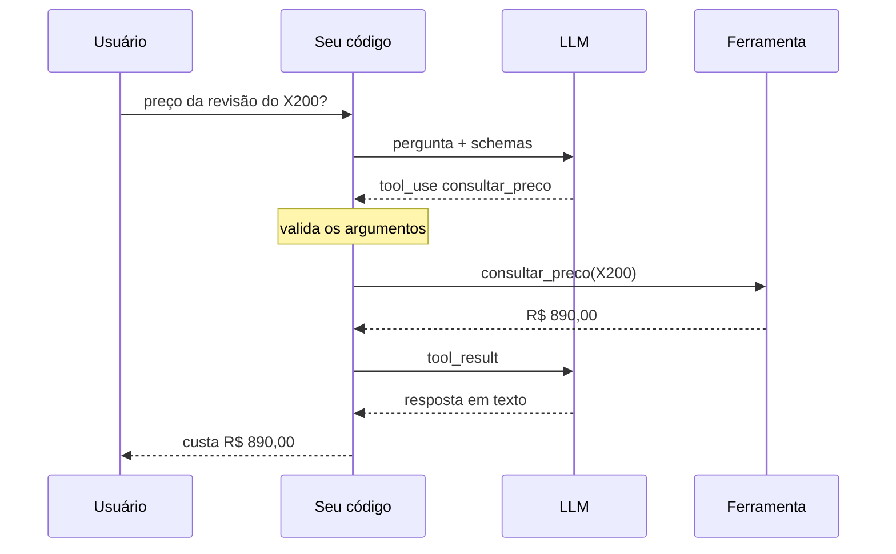

## O que é

Tool use (uso de ferramentas, também chamado function calling) é o mecanismo em que o modelo não executa nada: ele devolve o nome de uma ferramenta e os argumentos, em formato estruturado. Quem executa é o seu código, que devolve o resultado ao modelo para ele continuar. Uma ferramenta é uma função sua, como `buscar_ordem(numero)`.

## Por que importa para um AI Engineer

Esse loop é a base de todo agente. Sem ele, o modelo só gera texto; com ele, consulta sistemas, abre chamados e lê arquivos. Também é onde ficam os riscos: o que o modelo pede passa pelo seu código, e é ali que você valida, limita e registra.

## Como funciona

1. Você descreve cada ferramenta com nome, descrição e um schema (a definição dos argumentos, em JSON Schema: tipos e campos obrigatórios).
2. O modelo decide se precisa de uma ferramenta e responde com a chamada (nome e argumentos) em vez de texto final.
3. Seu código valida os argumentos, executa a função e devolve o resultado numa mensagem de resultado de ferramenta.
4. O modelo lê o resultado e responde, ou pede outra ferramenta. O ciclo se repete até haver uma resposta final.



```python
import anthropic
cliente = anthropic.Anthropic()
ferramentas = [{"name": "buscar_ordem", "description": "Busca uma ordem de manutenção pelo número.",
    "input_schema": {"type": "object", "properties": {"numero": {"type": "string"}}, "required": ["numero"]}}]
msgs = [{"role": "user", "content": "Qual o status da ordem OM-1042?"}]
for _ in range(5):                                   # teto de voltas
    r = cliente.messages.create(model="NOME-DO-MODELO", max_tokens=500, tools=ferramentas, messages=msgs)
    if r.stop_reason != "tool_use":
        break
    msgs.append({"role": "assistant", "content": r.content})
    uso = next(b for b in r.content if b.type == "tool_use")   # pode haver mais de uma
    resultado = f"Ordem {uso.input['numero']}: em andamento"    # seu código executa aqui
    msgs.append({"role": "user", "content": [{"type": "tool_result", "tool_use_id": uso.id, "content": resultado}]})
print(r.content[0].text)
```

Os nomes dos campos (`input_schema`, `tool_use`, `tool_result`) são os da API da Anthropic; outros provedores usam outros nomes, como `parameters` e `tool_calls`, mas a estrutura do loop é a mesma. Consulte a documentação do provedor (a de function calling da OpenAI mostra o formato dela) e o nome atual do modelo.

**Erros.** Se a ferramenta falha, devolva a mensagem de erro ao modelo (a API da Anthropic tem o campo `is_error` no resultado): ele pode corrigir o argumento ou tentar outro caminho. Falhas temporárias, como tempo esgotado, você repete no seu código, com espera crescente entre as tentativas.

**Idempotência.** Uma operação é idempotente quando repeti-la tem o mesmo efeito que fazê-la uma vez. Consultar é idempotente; "criar chamado" não é, e uma nova tentativa pode criar dois. Para ações que escrevem, envie uma chave de idempotência (um identificador único da operação) e deixe o sistema ignorar a repetição.

## Na prática

No P1: Assistente da Montadora, a camada de ferramentas deixa o assistente consultar sistemas, como ordens de manutenção, em vez de só conversar. No P3: Servidor MCP de Manuais, as mesmas ferramentas passam a ser servidas por um protocolo padrão. Descrições claras valem muito: o modelo escolhe pela descrição, então diga quando usar e quando não usar cada ferramenta, e devolva só o que ele precisa ler.

## Erros comuns

- **Confiar nos argumentos.** O modelo pode inventar ou errar um valor. Valide tipo e faixa, e cheque permissão no seu código.
- **Loop sem teto.** Sem número máximo de voltas, um erro repetido vira custo infinito.
- **Ferramentas demais ou parecidas.** O modelo se confunde; prefira poucas, com nomes distintos.
- **Resultado enorme.** Devolver a tabela inteira enche o contexto; filtre e resuma.
- **Ação de escrita sem idempotência nem aprovação.** Veja human-in-the-loop.

## Como estudar

1. Leia a visão geral de tool use do provedor que você usa (2 horas).
2. Rode o exemplo com uma ferramenta que lê um dicionário (meio dia).
3. Adicione uma segunda ferramenta e um erro proposital, e veja o modelo reagir (1 dia).
4. Torne uma ferramenta de escrita idempotente com uma chave (1 dia).
5. Leia "Writing effective tools for AI agents" e reescreva as descrições (meio dia).

## Como mostrar

No portfólio, mostre o loop com um log de cada chamada: ferramenta, argumentos, resultado, tempo. Na entrevista, explique quem executa a ferramenta, o que você valida antes de executar e por que a idempotência importa numa nova tentativa.
