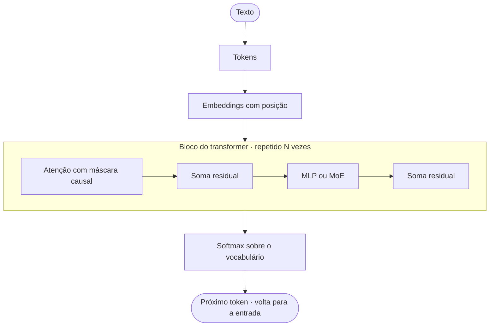

## O que é

O transformer é a arquitetura de rede neural por trás dos LLMs atuais. O texto vira tokens, cada token vira um vetor (embedding), e o modelo passa esses vetores por dezenas de blocos iguais. Cada bloco tem duas partes: a atenção, que deixa cada token olhar os anteriores e puxar informação deles, e uma rede feed-forward (MLP), que processa cada token sozinho. No fim, o vetor do último token vira uma distribuição de probabilidade sobre o vocabulário, e o modelo escolhe o próximo token.



## Por que importa para um AI Engineer

Sem esse modelo mental, várias decisões viram superstição. A atenção compara cada token com todos os anteriores, por isso o custo cresce com o tamanho do contexto. O modelo gera um token por vez, por isso a saída custa mais caro e demora mais que a entrada. A posição dos tokens é codificada no vetor, por isso a ordem do prompt muda a resposta. Saber isso ajuda a ler artigos novos, conversar com times de pesquisa e explicar numa entrevista por que uma escolha de arquitetura faz sentido.

## Como funciona

Na atenção, cada token gera três vetores: uma consulta (query, Q), uma chave (key, K) e um valor (value, V). A consulta de um token é comparada com as chaves dos outros por produto escalar; o resultado, normalizado por softmax, diz quanto de cada valor entra na mistura. Uma máscara causal impede que um token veja os que vêm depois dele.

```python
import torch

def atencao(x, Wq, Wk, Wv):
    Q, K, V = x @ Wq, x @ Wk, x @ Wv           # (tokens, d)
    notas = Q @ K.T / K.shape[-1] ** 0.5         # similaridade entre tokens
    mascara = torch.triu(torch.ones_like(notas), 1).bool()
    notas = notas.masked_fill(mascara, float("-inf"))  # não olha o futuro
    pesos = torch.softmax(notas, dim=-1)
    return pesos @ V                             # mistura dos valores

x = torch.randn(5, 16)                           # 5 tokens, dimensão 16
W = [torch.randn(16, 16) for _ in range(3)]
print(atencao(x, *W).shape)                      # torch.Size([5, 16])
```

Os modelos reais usam várias cabeças de atenção em paralelo (multi-head), conexões residuais, normalização e uma codificação de posição como RoPE. Muitos modelos recentes também trocam a MLP densa por uma mistura de especialistas (mixture of experts, MoE), em que só parte dos pesos é usada por token.

## Na prática

Quando um modelo "esquece" algo no meio de um contexto longo, quando o custo cresce mais que o esperado ou quando um modelo MoE grande roda mais rápido que um denso menor, a explicação está aqui. No P5: Pesquisador Multiagente, você usa esse conhecimento para escolher qual modelo serve cada subagente e para estimar memória e latência.

## Erros comuns

- **Achar que o modelo "lê" o texto como pessoa.** Ele processa vetores de tokens; palavras raras viram vários tokens.
- **Confundir parâmetros com conhecimento útil.** Um modelo MoE tem muitos parâmetros, mas usa só uma parte por token.
- **Ignorar a máscara causal.** Ela explica por que o modelo não pode "voltar" e corrigir um token já gerado.
- **Estudar só a fórmula.** Sem implementar, os detalhes de dimensão e máscara não fixam.

## Como estudar

1. Leia o artigo ilustrado do transformer e assista ao vídeo de atenção passo a passo (1 dia).
2. Rode o código acima, imprima a matriz de pesos e confira a máscara (1 dia).
3. Acompanhe o vídeo de construção de um GPT do zero, digitando o código (1 a 2 semanas).
4. Treine o nanoGPT num texto pequeno e varie o número de camadas e cabeças (1 semana).
5. Leia o artigo original e anote o que mudou nos modelos atuais: RoPE, MoE e normalização (2 dias).

## Como mostrar

Publique um repositório com seu mini-GPT treinado, um gráfico da perda e uma visualização dos pesos de atenção de uma frase. Na entrevista, desenhe um bloco do transformer e explique de onde vem o custo quadrático da atenção.
