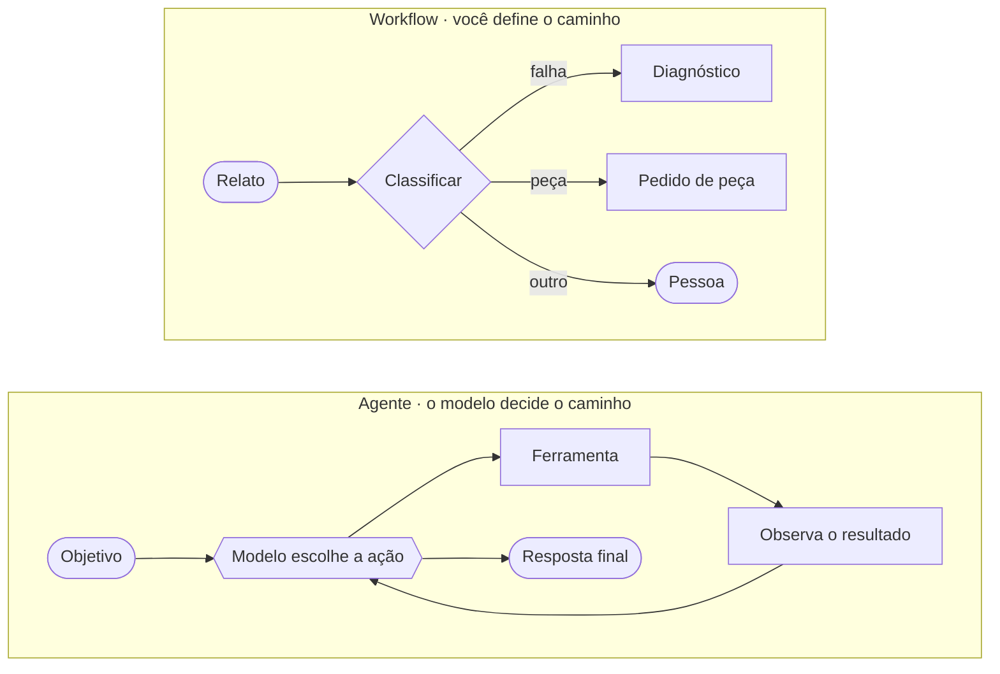

## O que é

Um workflow é um fluxo em que o código define os passos e o LLM (modelo de linguagem) é chamado em pontos fixos. Um agente é um sistema em que o próprio modelo decide o próximo passo, em loop, usando ferramentas, até concluir. A distinção é de quem controla o caminho: seu código ou o modelo.

## Por que importa para um AI Engineer

Escolher agente por padrão é um erro caro. O agente custa mais tokens (as unidades de texto que o modelo lê e escreve), demora mais, é difícil de testar e pode errar de formas imprevisíveis. O artigo "Building effective agents", da Anthropic, recomenda começar pela solução mais simples e só aumentar a complexidade quando isso melhora o resultado. Saber dizer "aqui basta um workflow" mostra maturidade.

## Como funciona

O artigo descreve cinco padrões de workflow, do mais simples ao mais complexo:

- **Encadeamento (prompt chaining):** uma chamada alimenta a próxima. Exemplo: extrair campos do relato do operador e depois redigir a ordem.
- **Roteamento (routing):** uma primeira chamada classifica a entrada e a envia ao tratamento certo (falha, peça ou outro), cada um com seu prompt.
- **Paralelização (parallelization):** tarefas independentes rodam ao mesmo tempo, ou a mesma tarefa roda várias vezes para votar.
- **Orquestrador e trabalhadores (orchestrator-workers):** um modelo divide a tarefa em partes que ele só descobre ao ler a entrada e delega cada uma a outra chamada.
- **Avaliador e otimizador (evaluator-optimizer):** uma chamada produz, outra critica, e o ciclo repete até passar no critério.

O exemplo abaixo é pseudocódigo de roteamento; `llm` representa a sua chamada ao modelo:

```python
def llm(prompt): ...   # pseudocódigo: chamada ao modelo, devolve texto

def tratar(relato):
    tipo = llm(f"Responda só 'falha', 'peca' ou 'outro': {relato}")
    if tipo == "falha":
        return llm(f"Sugira o diagnóstico: {relato}")
    if tipo == "peca":
        return llm(f"Liste as peças citadas: {relato}")
    return "Encaminhar a um humano"
```

Os passos são conhecidos e cada um pode ser testado sozinho. Compare com o agente: você dá ferramentas e um objetivo, e o modelo escolhe o que chamar, em que ordem e quando parar. Isso ganha flexibilidade e perde previsibilidade.



**Quando o agente compensa:** quando o número e a ordem dos passos dependem do que aparece no caminho, como investigar uma falha que pede buscas diferentes a cada vez, e quando um erro tem custo aceitável ou passa por aprovação humana. Mesmo então, ponha limites: número máximo de voltas, orçamento de tokens e ferramentas só com o acesso necessário. O artigo de pesquisa multiagente da Anthropic relata que agentes gastam bem mais tokens que um chat e que sistemas com vários agentes gastam ainda mais, e por isso só valem em tarefas de alto valor e parte paralelizável.

## Na prática

O P4: Triagem de Ordens de Manutenção é um workflow de propósito: extrai, classifica e sugere procedimento em passos fixos, e o README explica por que não é um agente. O PF: Agente Completo, ao contrário, usa um agente com ferramentas MCP e aprovação humana, porque a investigação de uma falha não tem roteiro fixo. Um bom hábito é começar cada projeto como workflow e promover a agente só onde um passo fixo não resolve.

## Erros comuns

- **Agente para tudo.** Se você consegue escrever os passos, escreva-os.
- **Multiagente cedo demais.** Divide o contexto e multiplica o custo; use só para trabalho realmente paralelo.
- **Sem condição de parada.** Loops sem teto de voltas ou de gasto.
- **Não medir.** Compare workflow e agente no mesmo conjunto de testes, em qualidade, custo e tempo.
- **Framework antes de entender.** Veja primeiro o loop na mão.

## Como estudar

1. Leia "Building effective agents" inteiro (2 horas).
2. Implemente o roteamento acima com uma API real e 10 relatos de exemplo (1 dia).
3. Reescreva a mesma tarefa como agente com duas ferramentas e compare custo em tokens e tempo (2 dias).
4. Leia o artigo do sistema multiagente e anote o que justificou esse custo (2 horas).

## Como mostrar

No README, inclua uma tabela comparando workflow e agente na mesma tarefa: qualidade, tokens e tempo, com o método de medida. Na entrevista, defenda uma escolha com esses números e explique quando você trocaria de lado.
